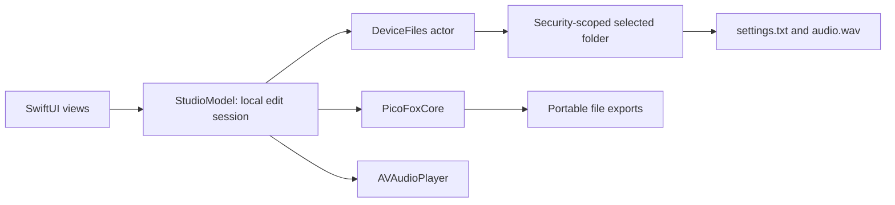

# Architecture

The application has three boundaries: portable data/algorithms, Apple services, and SwiftUI presentation. Files are the interchange format; there is no radio command protocol.

All Apple-platform presentation uses native SwiftUI: `Form`, `NavigationSplitView`, `TabView`, `ToolbarItem`, `Menu`, `ProgressView`, `Slider`, `Picker`, and `Canvas` for the waveform. Progress appears in a content safe-area inset so toolbar compression cannot clip its indicator. Hidden control labels retain accessibility names; `ViewThatFits` chooses labeled or icon-only audio actions as space permits. The Mac window has a 640 × 520 minimum content size.

Apple references: [Form](https://developer.apple.com/documentation/swiftui/form), [ProgressView](https://developer.apple.com/documentation/swiftui/progressview), [labelsHidden](https://developer.apple.com/documentation/swiftui/view/labelshidden()), [ViewThatFits](https://developer.apple.com/documentation/swiftui/viewthatfits), and [safeAreaInset](https://developer.apple.com/documentation/swiftui/view/safeareainset(edge:alignment:spacing:content:)-6gwby).

iOS text entry uses one root `FocusState<StudioInput?>`, shared by radio, tone, speech and trim fields. Only the active screen adds a full-width bottom `safeAreaInset` while a field is focused. Its native `HStack` has a Done button with a 44-point minimum height and a `.bar` background; clearing focus dismisses the keyboard. Keyboard types and interactive scroll dismissal remain field-appropriate. This uses neither a `.keyboard` toolbar nor fixed extra safe-area padding. Audio action labels keep a 44-point minimum touch area on iOS while retaining native Mac sizing. References: [FocusState](https://developer.apple.com/documentation/swiftui/focusstate), [safeAreaInset](https://developer.apple.com/documentation/swiftui/view/safeareainset(edge:alignment:spacing:content:)-6gwby), [keyboardType](https://developer.apple.com/documentation/swiftui/view/keyboardtype(_:)), [scrollDismissesKeyboard](https://developer.apple.com/documentation/swiftui/view/scrolldismisseskeyboard(_:)), and [Apple touch-target guidance](https://developer.apple.com/design/tips/).

Radio frequency warnings appear next to the frequency field, including when other settings are invalid. `PicoFoxSettings.frequencyRangeMHz` and `frequencyIssue` supply the same zone-specific bounds to inline feedback, aggregate validation and serialization. Custom tone frequency has its own inline 100–2000 Hz warning; invalid frequency or duration disables generation.

## Component map

| File | Responsibility | Porting boundary |
|---|---|---|
| `Package.swift` | Standalone dependency-free library/test graph | Swift toolchains; no Apple UI dependency |
| `Sources/PicoFoxCore/Settings.swift` | Settings value model, validation, tolerant unknown-key retention, canonical known-key serialization | Reuse or reimplement against conformance vectors |
| `Sources/PicoFoxCore/DeviceAudio.swift` | Narrow compatibility reader for firmware-generated WAV length mismatches | Shared format validation; no device writes |
| `Sources/PicoFoxCore/FactoryAudio.swift` and `Resources` | Original factory recording, canonical header, bundled attribution and license | Reuse asset plus provenance; SwiftPM resource access or native asset loader |
| `Sources/PicoFoxCore/PowerLevel.swift` | Nominal r3 mW mapping from firmware attenuation | Reuse math; replace reference with measured calibration when available |
| `Sources/PicoFoxCore/WaveAudio.swift` | WAV decoding, mono sample model, DSP, waveform peaks, canonical WAV encoding | Reuse or port math and byte layout |
| `App/PicoFoxApp.swift` | Application entry, root state ownership, settings-draft restoration, scene-active monitoring and Mac mount/unmount triggers | Replace with target-platform lifecycle |
| `App/Services/StudioModel.swift` | Observable editor state, retained device snapshot, availability checks, asynchronous orchestration, draft persistence, playback and export document | Split into session state plus platform playback/export adapters in ports |
| `App/Services/AudioPlayback.swift` | Delegate-driven playback, progress, pause/resume, seeking, transition fades and audio-session ownership | Native audio player/route adapter |
| `App/Services/AudioPreview.swift` | Fast native sample-rate conversion for local audition | Replace with a high-quality native converter or the portable core fallback |
| `App/Services/AudioImport.swift` | Bounded Apple audio-file decoding into editable mono samples | Replace with platform codec support; portable PCM WAV decoding remains available |
| `App/Services/SpeechAudio.swift` | Available system voices, cancellable speech-to-PCM generation and bounded sample collection | Replace with a platform TTS renderer returning PCM rather than playing aloud |
| `App/Services/AudioCapture.swift` | On-demand microphone permission, local PCM WAV recording, elapsed time and two-minute stop | Replace with platform recorder; feed resulting WAV into shared decoder |
| `App/Services/DeviceFiles.swift` | Serialized file access, scoped bookmarks, settings availability probes, coordination, byte comparison, backups and verified writes | Replace with platform folder capability/storage service |
| `App/Views/StudioView.swift` | Two-screen tabs/sidebar, shared input focus and focused-only Done inset, Files menu, import/export presentation, progress, connection indicator, error alerts and replacement confirmations | Native navigation shell per platform |
| `App/Views/RadioSettingsView.swift` | All radio settings, issues, draft/export/direct-save actions | Bind to shared settings schema |
| `App/Views/AudioEditorView.swift` | Waveform and non-destructive edit controls | Bind to edit recipe and rendered output |
| `App/Views/AudioCreationView.swift` | Inline custom tone and speech controls on the Audio screen | Bind to portable tone parameters or a platform speech renderer |
| `project.yml` / `PicoFox.xcodeproj` | Native iOS and native Mac app targets, local package dependency, schemes and capabilities | Apple only |
| `App/PicoFoxMac.entitlements` | Sandbox, selected-file read/write and scoped bookmark access | Apple only |
| `Tests/PicoFoxCoreTests/CoreTests.swift` | Portable behavioral tests | Port tests with implementation |
| `AppleTests/DeviceFilesTests.swift` | Actual local-folder snapshot/write/backup/conflict tests | Equivalent tests for each storage adapter |
| `Fixtures/` | Settings/WAV examples and JSON behavior vectors | Shared across implementations |

## State and ownership

`PicoFoxApp` owns one `@Observable` main-actor `StudioModel`. The window content receives it explicitly. Multiple Mac windows share this editing session. Child views bind its settings and edit controls. The model owns the `DeviceFiles` actor, `AudioCapture` and `AudioPlayback` services. Recording stops when the app backgrounds, on Stop, after an interruption, or at two minutes. Its temporary WAV is decoded into the same editor source and removed.

An audio source is immutable from the editor’s perspective. Trim/gain/normalization/fade form a recipe. Rendering copies the selected range, applies DSP, resamples, and encodes into an export buffer in a detached task. Full-quality playback uses 48 kHz edited PCM; an explicit PicoFox mode auditions device bandwidth at the same hardware playback rate. Device export stays 5 kHz. The displayed waveform represents the imported source; selection shading represents the trim, while gain/fade changes are heard in preview. Parameters cannot change while an operation is busy. Changing audio controls stops playback.

File operations run on `DeviceFiles`, separate from main-actor presentation. Core DSP is `Sendable` value data with no knowledge of URLs, UI, security scopes, or devices. Errors become readable alerts and preserve the existing edit session where possible. Unsupported device audio can be replaced after settings open successfully.

While the scene is active, `StudioModel` checks the already authorized folder and parses `settings.txt` every two seconds, skipping busy operations. Mac `NSWorkspace` mount/unmount notifications trigger an immediate check. Monitoring stops when the scene becomes inactive. Availability is an operational access result: removed media, missing/invalid settings and permission failures can all make a folder unavailable. It is not a definitive physical USB detector.

The device snapshot and local settings/audio edits survive failed probes. Direct saves are disabled until access returns; recovery does not reload files or replace edits. Initial automatic reopening may load the saved folder only into an untouched session, and explicit **Close folder** suppresses it. New iOS folder access still requires [Apple’s directory picker](https://developer.apple.com/documentation/uikit/providing-access-to-directories); [`mountedVolumeURLs`](https://developer.apple.com/documentation/foundation/filemanager/mountedvolumeurls(includingresourcevaluesforkeys:options:)) cannot enumerate volumes there. Routine success banners are removed; actual errors and confirmations for replacing edits remain.

Factory-audio restoration backs up the local editor before replacing it. If the selected folder is unavailable, restoration remains local and never attempts a device write. An available folder uses the normal device backup/conflict/verified-save pipeline.

## File save lifecycle

1. The folder picker supplies a capability (security-scoped URL).
2. Open obtains coordinated local snapshots of settings and optional audio, plus a bookmark. Audio read failures are retained separately so settings can still open; unreadable originals cannot be replaced directly. A settings file is required so an arbitrary empty folder is not silently populated.
3. Edits affect only memory. `Files → Keep settings draft` explicitly saves settings as JSON in Application Support/PicoFox/draft.json; invalid intermediate values can be retained in drafts.
4. Direct save resolves the bookmark, starts scoped access, and coordinates the destination write.
5. Compare destination bytes with the opened/successfully-saved snapshot. A difference or unexpected creation/deletion is a conflict, even if the desired output happens to match.
6. Copy existing destination bytes to Application Support/PicoFox/Backups/<UUID>/<filename>. Failure to back up stops the write.
7. Write atomically, then compare read-back bytes with the intended output. Update the expected snapshot only on success.
8. Stop scoped access in `defer`.

There is no cross-file transaction. An audio save and a settings save may succeed independently. Atomic rename/read-back is an application-level protection, not a guarantee against physical unplugging, power loss or USB firmware flush failures. No automatic rollback is attempted following uncertain device writes. Originals remain in local backups for deliberate recovery.

The editor uses snapshots instead of live file presentation. Availability probes do not import external content changes; optimistic comparisons catch those changes at direct save. Other applications which do not cooperate with NSFileCoordinator can still race a write. Reselecting a folder replaces the local session after confirmation.

## Extension points

For additional transports, preserve the core and introduce a storage capability with `openSnapshot`, `readExpected`, `saveVerified`, `backupOriginal` and `close`. Do not put platform path assumptions in core validation or DSP. For new firmware, add a versioned compatibility profile before broadening limits. Do not assume every device bearing this USB volume name has the same firmware.
